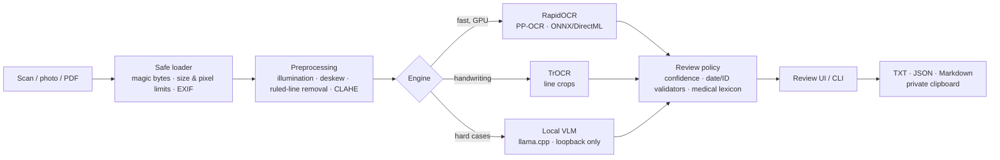

<div align="center">

# 🪶 QuillVault

**Private, offline handwriting OCR for sensitive documents.**
Your scans never leave your machine.

[](https://github.com/JuanAvendan/quillvault/actions/workflows/ci.yml)
[](https://github.com/JuanAvendan/quillvault/actions/workflows/codeql.yml)
[](LICENSE)


[Español](README.es.md) · [Security model](SECURITY.md) · [Technical evaluation](docs/evaluacion-tecnica.md)

</div>

---

QuillVault turns photos and scans of **handwritten** documents into editable, copyable
text — entirely on your own computer. It was built for clinical paperwork (patient
records that feed Colombia's RIPS reporting), where sending images to a cloud OCR API
is not an option.

* **100 % local inference.** No cloud APIs, no telemetry, network access only for an
  explicit, one-time model download.
* **Handwriting-first.** Line detection + handwriting recognisers (TrOCR) and an optional
  local vision-language model for difficult writing.
* **Human in the loop.** Every uncertain line is flagged; nothing is corrected silently.
* **Runs on any GPU.** ONNX Runtime + DirectML works on AMD, Intel and NVIDIA on Windows;
  CPU fallback everywhere.
* **Measurable.** Built-in CER/WER benchmark and a generator for *synthetic*
  practice sheets, so you can evaluate and fine-tune without touching real patient data.

## How it works



| Engine | Best for | Speed (RX 6650 XT) | Confidence score | Licence |
|---|---|---|---|---|
| `rapidocr` | Printed or neat writing, line detection | ~0.2 s/page (GPU, DirectML) | ✅ | Apache-2.0 |
| `trocr` | Cursive handwriting (fine-tunable to one writer) | ~1.4 s/line (CPU, Ryzen 7 5700X) | ✅ | MIT |
| `vlm` | Very difficult handwriting | seconds/page (GPU, Vulkan) | ❌ → always reviewed | Apache-2.0 (Qwen2.5-VL-7B) |

## Quick start

Requires [uv](https://docs.astral.sh/uv/) and Windows 10/11 or Linux.

```bash
git clone https://github.com/JuanAvendan/quillvault.git
cd quillvault

# Windows with any GPU (AMD/Intel/NVIDIA) — use --extra cpu elsewhere
uv sync --extra directml --extra ui --extra trocr --extra pdf --extra templates

uv run quillvault doctor          # check GPU, models and privacy settings
uv run quillvault ui              # review UI on http://127.0.0.1:7860
```

### Command line

```bash
# Print text (lines needing review are reported on stderr)
uv run quillvault extract scan.jpg

# Whole folder → JSON with confidences and review flags
uv run quillvault extract scans/ --engine trocr --format json --out results/

# Copy to the clipboard, excluded from Windows clipboard history, wiped after 45 s
uv run quillvault extract scan.jpg --copy

# Handwriting model (one-time download, pinned revision, safetensors only)
uv run quillvault models download trocr-base-handwritten
```

### Python API

```python
from pathlib import Path
from quillvault import Pipeline

pipeline = Pipeline("rapidocr")
for source, page in pipeline.process_paths([Path("scan.jpg")]):
    for line in page.lines:
        print(f"{line.confidence or 0:.0%}  {'⚠' if line.needs_review else ' '}  {line.text}")
```

## Evaluate on your own handwriting — without real data

```bash
uv run quillvault templates practice/ --pages 10     # PDF with FAKE clinical lines + ground truth
# The writer copies each page by hand; save scans as practice/pagina_001.jpg, ...
uv run quillvault benchmark practice/ -e rapidocr -e trocr -e vlm --out benchmark.md
```

The benchmark reports **CER, accent-insensitive CER, WER, seconds per page and % of
lines flagged**. It never includes recognised text, so it is safe to share.

### Results

> 📊 Benchmark on the writer's practice sheets: *coming soon* (Phase 1).

## Privacy & security

QuillVault is designed for health data (sensitive personal data under Colombian
Law 1581/2012). Highlights — the full threat model is in [SECURITY.md](SECURITY.md):

| Risk | Mitigation |
|---|---|
| Images uploaded to third parties | No cloud engines. The VLM client only accepts loopback addresses and ignores proxy variables. |
| Silent network calls | Offline mode forced for model libraries; Gradio analytics and HF telemetry disabled; system fonts (no Google Fonts). |
| Malicious files | Type checked by magic bytes, 50 MB / 80 MP limits (decompression bombs), PDF page cap. |
| Tampered models | Pinned commit hashes, `safetensors` only (no pickle). |
| Data left on disk | Uploads, previews and exports live in a private temp dir deleted on exit. |
| Leaks via logs | Text and filenames are never logged; a redacting filter masks IDs, paths and e-mails. Page IDs are content hashes. |
| Clipboard history | Text is tagged to skip Win+V history and cloud sync, and is wiped after 45 s. |
| Real scans in Git | `.gitignore` + pre-commit/CI hook that blocks images and documents. |

> QuillVault is a tool, not a compliance certification. Use full-disk encryption
> (BitLocker/LUKS) and your organisation's data-protection procedures.

## Project layout

```
src/quillvault/
├── imaging/        safe loading, preprocessing, line crops
├── engines/        rapidocr · trocr · vlm (strategy pattern)
├── postprocess/    validators (dates, IDs, CIE-10), lexicon suggestions, review policy
├── security/       offline mode, loopback guard, redaction, temp files, private clipboard
├── ui/             Gradio review app (127.0.0.1 only)
├── benchmark.py    CER/WER scoring
├── templates.py    synthetic practice sheets
└── cli.py          Typer CLI
```

## Roadmap

- [x] Phase 0 — engines, preprocessing, review UI, benchmark, security hardening, CI
- [ ] Phase 1 — benchmark on the writer's practice sheets
- [ ] Phase 2 — fine-tune TrOCR on synthetic sheets, export to ONNX/DirectML
- [ ] Phase 3 — form-zone extraction mapped to RIPS fields
- [ ] Phase 4 — optional on-premise API (Python or C#/.NET via ONNX Runtime)

## Development

```bash
uv sync --extra cpu --extra templates --extra pdf   # + --extra ui/trocr as needed
uv run pre-commit install
uv run pytest --cov
uv run ruff check src tests && uv run mypy src
```

## Acknowledgements

[RapidOCR](https://github.com/RapidAI/RapidOCR) ·
[PaddleOCR](https://github.com/PaddlePaddle/PaddleOCR) ·
[TrOCR](https://huggingface.co/microsoft/trocr-base-handwritten) ·
[llama.cpp](https://github.com/ggml-org/llama.cpp) ·
[Qwen2.5-VL](https://huggingface.co/Qwen/Qwen2.5-VL-7B-Instruct) ·
[Gradio](https://www.gradio.app/)

## License

[Apache-2.0](LICENSE) © 2026 Juan Avendaño
